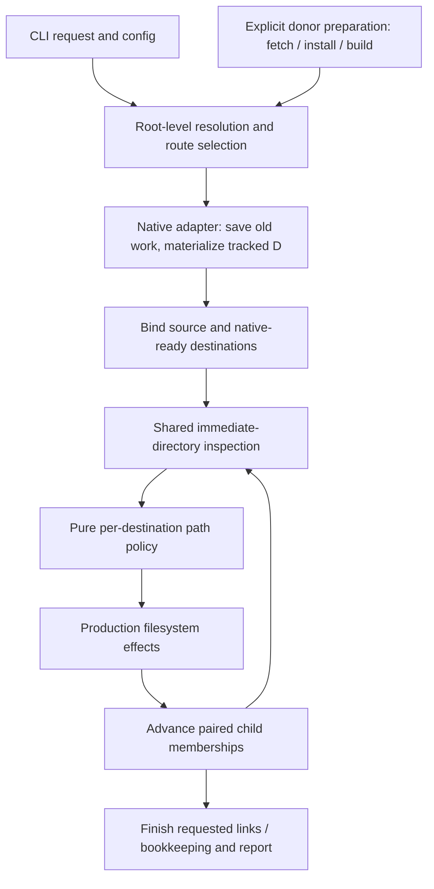

# Streaming reseed with upfront route selection

## 1. Purpose and standing

Make frequent reseeding fast enough to use routinely and simple enough to explain
from its actual execution. A command selects its source, destinations and strategy;
native JJ operations establish tracked state; one coordinated traversal discovers
and performs authorized ordinary-file work. Unexpected errors terminate the run
with its actual partial effects left in place.

This is the current technical proposal for the whole command. It incorporates the
human's lifecycle direction and supersedes the earlier assessments' ambiguous
“capture inputs” phase. It does not claim implementation or measured speedup.

Three boundaries are fundamental:

1. **Upfront decisions use configuration, root facts and recorded native identity.**
   They do not recursively inspect the payload or enumerate every tracked path.
2. **Native JJ work has an explicit cost and purpose.** Saving edits can walk a
   working copy; obtaining a tracked-path list enumerates a repository tree. Neither
   becomes free merely because it is called capture, planning or preparation.
3. **Filesystem inspection and effects progress together.** An immediate directory
   batch supplies the observations for its decisions and writes. There is no prior
   all-files eligibility, validation or operation-map pass.

Seed remains useful but secondary: initialize a new native receiver, then reuse the
transfer and finishing components. Its old batch rollback and recreation behavior
do not determine the new reseed architecture.

## 2. Vocabulary and successful result

| Term | Meaning |
| --- | --- |
| S | The recorded tracked revision associated with the prepared donor. Its live files are assumed to represent that prepared state. |
| D | The desired tracked revision for this invocation; normal reseed uses S, an explicit revision can select another D. |
| Oᵢ | Destination i's old tracked revision after the requested preservation snapshot. |
| Native route | A selected procedure for renewing tracked sharing and establishing D while retaining receiving identity. |
| Transfer policy | Authority over ordinary paths: copy/update, mirror, preserve, or route through a structural directory. |
| Lane | One destination's membership, decisions, effects and result in the shared traversal. |
| Native-ready | The selected native procedure has established the intended tracked state and completed any validation that procedure needs. |

Successful reseed retains the receiving root and native workspace identity,
establishes an empty child of the intended D under the chosen native semantics,
renews the promised tracked CoW sharing, satisfies the selected ordinary-data
policy, and completes requested links/bookkeeping. Auxiliary equality remains the
library's stat/literal-link model; it is not byte-integrity certification.

Failure can leave any already-started receiver partly changed. Completed receivers
remain; other receivers need not be finished. The command reports failure rather
than synthesizing rollback, restarting with another strategy, or certifying partial
results as a successful batch.

## 3. Architecture and owners



The loop ends on traversal exhaustion; any returned unexpected error exits its
current phase. Native commands are serial initially. The diagram does not imply
that every copied subtree becomes a coordinated child: one-sided recursion is
owned by the effect kernel.

| Owner | Responsibility |
| --- | --- |
| `reseed` command | Root selection, lifecycle policy, phase ordering, fail-fast behavior, diagnostics and command result. |
| Native adapter through `JjClient` | Revision reads, preservation snapshots, native metadata, tracked materialization and native result checks. |
| Transfer policy adapter | Compile user authority and native/link exclusions into pure early/late decisions. |
| diff-dirs `tree` | Directory observation, shared source facts, comparison, validated decisions, paired traversal and coverage. |
| diff-dirs `transfer/sync` | Reflinks/copies, recursive one-sided work, staging, removals, permissions, timestamps and returned work accounting. |
| Existing links/metadata owners | Requested local finishing operations. |

These are module boundaries, not a requirement to introduce a public trait or a
framework for each row. The command should be readable as one ordinary forward
function calling a few substantial operations.

## 4. Phase A: root-level decisions

### Inputs and permitted work

Resolve the requested donor, registered destination roots, literal/group selection,
desired revision, transfer controls and explicit finishing options. Read recorded
JJ identities/revisions without implicit working-copy snapshots. Inspect actual
root/administrative paths and relevant environment facts: source/target separation,
supported JJ/native profile, sparse/monitor/colocation state and filesystem support.

Compile declaration strings into path matchers. Read configuration once. Native
version/capability information is command-owned, not re-queried for each file.
Use an existing topology snapshot where relevant; stable topology is an operating
assumption rather than something re-proved throughout the walk.

Select the native route and required copy mode. If a disposable reflink probe is
needed, perform a small probe for the actual source/destination pairing, amortizing
only where its relevant filesystem conditions genuinely match. A successful probe
does not promise every later file operation can succeed.

This phase scales with selected workspaces, configuration and native metadata
queries, not the number of payload entries. It does not call `file list`, a payload
selector walk, recursive audit, `verify_disk` or an implicit snapshot as a generic
way to establish readiness.

### Donor preparation is a separate producer

`jw prepare` performs the explicitly requested fetch/native advancement/install/
build workflow and reports its prepared revision. `reseed --prepare` composes that
producer before selecting the final source revision and route. Its real work is
reported separately; it is not hidden under a cheap preflight label.

Proposed normal reseed consumes an already-prepared donor, using recorded S plus
the live donor files under the quiescence assumption. It does not resnapshot that
donor by default. This differs from the shipped implicit donor snapshot and needs
an explicit CLI/documentation change. Recorded S alone does not prove disk equality.
If an explicitly requested source assertion promises live equality, performing its
one native snapshot/check is a named additional operation with an accounted cost.

### Upfront choice versus runtime failure

Known unsupported configurations fail before destructive refill. Once chosen, a
route is fixed. A failed required reflink, rejected native cache or permission error
returns through that route; it does not trigger ordinary-copy downgrade, destination
recreation or a second algorithm. Supporting an alternative mode is a separate
upfront selection, not an exception handler in the iteration.

Path-specific conflicts can still be found during execution. Root-level assessment
does not pretend to know every future entry. Those conflicts are ordinary errors,
not evidence that an all-files preflight must be reinstated.

## 5. Phase B: native execution, with a pass budget

### Saving old work

Before destructive tracked changes, perform the destination snapshot required to
save outstanding tracked edits and record Oᵢ. This can traverse the destination
working copy and read/hash changed tracked contents. It is an intentional native
operation, not a read-only metadata query or a scan of payload to plan transfer.

Do it once per destination for this purpose. Subsequent metadata queries must not
accidentally trigger additional snapshots. Print or retain old revision coordinates
for error reporting. Whether a covering bookmark is required is a separately
selected history policy; no automatic bookmark creation is inherent in this design.

### Native materialization routes

The preferred optimization to investigate is **donor state reuse for the normal
D=S profile**. The existing proven sparse/equal-leaf route is the general control.
Select supported routes from root/native facts and the S/D relationship, not by
trying one and catching errors to select the other. Selection does not pre-certify
path-specific admission.

| Route | Concrete work | Explicit costs and limits |
| --- | --- | --- |
| Donor-state reuse candidate | Preserve Oᵢ; use the native transition to clear old tracked contents and establish a receiving child; install all required S-tracked leaves; reuse only the donor's content/tree-state knowledge; native validation/convergence establishes D. | Needs accurate copied S contents and receiving-owned checkout identity. The current listed installer requires S membership. Native validation may still read/hash files. Existing-target production support must be completed, not inferred from the creation implementation. |
| Equal-leaf/native materialization | Preserve Oᵢ; sparse-clear tracked contents; remove only native recorded residual leaves; create child of D; install S/D-equal tracked leaves; native sparse expansion supplies the remaining D contents; establish the native result. | Enumerates S/D repository membership/difference data and may require Oᵢ paths for residual removal. Per-target tracked installs remain. Expansion can leave placeholder stats needing a native read/hash pass. |

This document does not invent a validated stock-JJ recipe beyond the existing
evidence. The first implementation slice must select and prove the exact sequence
of native commands for the supported profile. The architecture fixes its inputs,
ownership, failure behavior and pass accounting so that native experimentation
cannot grow into a new lifecycle framework.

**Moving an enumeration into this phase does not eliminate its cost.** If an adapter
needs tracked membership, read it from JJ's repository tree once per distinct tree,
share it across targets, and reuse it for both installation and transfer exclusions.
Do not obtain one inventory for preflight and another for execution. Do not stat
every listed leaf first merely to validate the list, then stat it again to copy it.

The library's `seed_leaves` is an appropriate existing installer for explicit known
tracked leaves. Ordinary stat-equal synchronization cannot replace it when the
requested outcome is renewal of CoW sharing. A future whole-donor physical route
could reduce membership-driven installation, but it requires an explicitly selected
authority over that whole ordinary namespace; it is not a free optimization of
selected-region copying.

### Native membership and retained locals

Donor `tree_state` carries tracked membership, not merely stat hints. With S≠D,
an S-tracked path that D omits can absorb a retained local and then be removed by
restore. D=S avoids that particular removal case but does not make arbitrary local
obstructions harmless. The adapter must apply the selected namespace ownership
contract; an incompatible path can fail the selected route.

Choose the general native route upfront for profiles where source-state reuse is
not supported. An overlap test may use already-needed repository membership and
configured retained regions. It must not require a speculative recursive census
of all local files simply to decide whether an optimization might work.

Return each receiver to native-ready state before the long ordinary-data cohort
when using the sparse route. On a native error, stop; do not clear additional targets
or collect failed targets into a best-effort retry scheduler.

## 6. Phase C: policy evaluated during the transfer

### Authority table

The adapter must produce the following behavior from declarations, native facts
actually required by the chosen route, and the current directory's observations:

| Path class | Decision |
| --- | --- |
| Receiving `.jj` and applicable native administrative paths | Preserve pair-wide before child observation; never copy donor identity. |
| Tracked leaves owned by S or D during auxiliary transfer | Preserve the whole corresponding name so donor-only tracked paths cannot be reintroduced and desired paths cannot be replaced. |
| Ancestors containing tracked leaves | Route through directories; refuse an incompatible leaf replacement. Do not preserve the whole ancestor and thereby hide ordinary siblings. |
| Explicitly retained local region | Preserve pair-wide; no traversal or effects inside it. Native materialization must respect the same declared ownership. |
| Link-owned path | Exclude from ordinary transfer; the links owner performs requested finish work. |
| Mirror-authorized region | Copy/update source-present contents and remove target-only contents, subject to preserves. |
| Update-authorized region | Copy/update source-present contents; retain target-only data. |
| Structural route to a selected descendant | Keep/create the necessary directory and continue assessment without granting blanket deletion authority. |
| Outside the selected authority | Preserve. |

An explicit preserve/native ownership conflict is an error, not a silent change
to D. Root/path spelling, symlink leaves and directory/leaf collisions retain the
library's real observation and replacement semantics.

### Eliminate root discovery before reconciliation

The current `Auxiliary::legacy` constructor consumes **realized roots**, supplied
by an earlier source discovery/ignoredness traversal. It is not the finished
architecture. Reusing it unchanged would retain the extra iteration challenged
by the human.

The proposed replacement compiles **declared authority** into a path policy:

```text
decision(relative path, supplied presence/kind, native ownership)
    → preserve | route | update | mirror | refuse
```

A matcher answers both “is this path inside a declared region?” and “could a
descendant be selected?”. For a pattern such as `**/node_modules`, discovery occurs
while walking the name union. Routing directories are visited once as required by
the traversal. An excluded branch is not recursively inspected. Cached early kind
can be Unknown; defer a kind-dependent decision to late observation rather than
secretly performing filesystem I/O in the matcher.

A recursive pattern can require visiting many routing directories to discover its
matches. “Streaming” removes a separate discovery pass; it does not make that
necessary discovery free. Explicit preserve boundaries and sound prefix rejection
can avoid interiors, while directory mtime cannot justify skipping them.

The preferred rule is that declaration supplies authority: a declared mirror also
has meaning when its corresponding source directory disappears. This changes the
old source-present, ignored-directory eligibility semantics. **It is a proposed
product change requiring selection**, not an already-authorized reinterpretation
of `copy_ignored`. Likewise, this architecture does not select broad update versus
broad mirror as the default for all other contents.

If old exact source-discovery/ignoredness behavior is retained, its real machinery
must be budgeted or redesigned explicitly. A pure visitor cannot call a Git ignore
subprocess or perform filesystem discovery to conceal that work. Frozen native
ignore rules, their dependency semantics and an inline implementation are a separate
requirement; the current persistent Git oracle is not a ready pure matcher. Do not
claim the legacy mode has become single-traversal merely because a cursor was added.

### Pure callbacks and state

Early and late policy use frozen configuration/native membership and supplied facts.
They do no native commands, printing, capability probing or mutation. Current
compiled matching can be a value inside one concrete visitor type with per-target
parameters. No ordered mutable discovered-root cache is shared between callbacks;
the library may call them speculatively or recursively.

Native source/desired membership, if needed, is an immutable sorted/prefix index
shared across lanes. The generic library does not parse JJ trees or understand
bookmarks. Ordered progress and failure reporting belong in the command loop.

## 7. The actual coordinated loop

Use `diff-dirs-tree-api` and `diff-dirs-transfer-sync` at their current package paths.
Bind at existing real workspace roots, so missing payload subdirectories are normal
source-only entries. Bindings reject root overlap; native initialization is outside
the cursor. All lane appliers share the same source root and required copy policy.

Illustrative Rust-shaped code, using delivered method names:

```rust,ignore
let runtime = SyncRuntime::new(targets); // SyncTarget { id, descriptor, applier }
let mut cursor = SyncCursor::new(&runtime, Execution::Sequential)?;

while let Some(group) = cursor.next_group(&runtime)? {
    // Inspection has returned and joined. Check group errors before its writes.
    for lane in &group.outcomes {
        if let Err(error) = &lane.outcome {
            return Err(with_target_and_phase(&lane.target, "inspect", error));
        }
    }

    for target in cursor.pending() {
        let applied = cursor.apply(&runtime, &group.token, &target)
            .with_context(|| format!("transfer to {target:?}"))?;
        record_returned_work(&target, &applied);
    }
    cursor.settle()?;
}

let reports = cursor.reports();
require_every_selected_lane_satisfied(&reports)?;
```

The helper names are proposed application functions, not existing APIs. `apply`
accepts the cursor's own selected plan and records its returned effects. Every
pending application is consumed, even when its immediate diff/work count is zero:
a retained target-only container may still own recursively removable children.

The command deliberately uses fail-fast error propagation rather than `drive`'s
healthy-peer continuation convenience. On error, gather the useful returned/partial
context without another filesystem walk, then return the original cause. There is
no retry of stale decisions, abandonment-as-success or automatic route switch.

### Recursive ownership and sharing limits

- The coordinated frontier owns matched-directory descent and destination membership.
- The production applier owns source-only copy, target-only removal and replacement
  interiors. JW must not recurse over those regions a second time.
- Paired groups share one source listing and demanded source facts. Destination
  listings, policies and effects remain per lane.
- A subtree missing in several destinations is still recursively copied per lane.
  Sharing does not mean every source syscall occurs once for the command.
- A group's applications finish before advancing dependent traversal. One slow
  opaque copy can delay the group; a returned error can follow completed siblings.

Default to sequential execution until actual whole-command evidence selects more
parallelism. A command-owned pool can later wrap the coordinated calls with
`pool.install`; this API does not use the pair walker's J/K frontier parameters.
Neither `par_iter` over entire target commands nor one pool per target is the
source-sharing mechanism.

## 8. Finish, failure and dry-run

After policy satisfaction, perform requested links and local bookkeeping. The native
adapter is responsible for establishing the successful tracked result. If later
operations can change tracked contents, account for one needed native verification
at the final relevant boundary. If enforced exclusions make that impossible,
snapshot-free native identity/parent queries can suffice at finish; do not perform
another whole-tree proof solely because a phase ended.

This distinction is implementation evidence to establish, not permission to omit a
necessary check. `status`, `restore`, sparse operations and a native verification
can each cause native work. Count what the selected route actually does.

Failure reports include phase, workspace/path where available, prior revision and
underlying cause. The command leaves completed effects in place. Temporary staging
cleanup and joined permission restoration remain responsibilities of the copy
kernel; they are not whole-workspace rollback. There is no mandatory continuation
serialization, durable progress ledger or automatic partial-workspace repair.

Dry-run is a separately requested assessment, not an implicit first execution phase.
Root-level route preview can remain cheap. A detailed filesystem preview must inspect
the participating tree and one-sided interiors. Current `Applier::preview` provides
that per destination; coordinated read-only comparison alone does not. Label which
coverage was produced. Running detailed preview and then executing performs two
requested inspections; ordinary execution should perform only its own inspection.

## 9. Data lifetime and cost accounting

| Data | Lifetime / source | Size and use |
| --- | --- | --- |
| Resolved request and chosen routes | Command; config/root/native metadata reads | O(destinations + declarations), apart from native registry/config size. |
| S, D, Oᵢ and receiving identities | Command; recorded queries and explicit target snapshots | Per-target coordinates, not file inventories. |
| Native membership/difference index | Only where the native route or transfer boundary needs it; repository tree data | O(relevant tracked paths), shared for equal tree inputs; not an auxiliary filesystem catalog. |
| Immediate source/destination facts | Library inspection/application runtime | Width-sensitive current plans; shared source facts and per-target unions. |
| Traversal state | Library cursor | Active frames, remaining children, lane memberships and summaries; width-sensitive. |
| Work counters/current phase | Command and library | Compact aggregates; obtain cloned reports at useful boundaries, not per file. |

### Pass ledger

Every new filesystem/native pass must have an entry like these:

| Work | Where charged | Purpose / multiplicity |
| --- | --- | --- |
| Root binding and configuration | Resolution | Once per command/selected binding; no descendant census. |
| Explicit donor install/build | Donor preparation | Requested producer work, measured separately. |
| Donor snapshot/assertion | Explicit producer/assertion only in proposed default | Live equality/recording requested by that operation; not repeated per target. |
| Destination snapshot | Native execution | Save outstanding tracked work once per target; may scan/hash. |
| Native path inventory/diff | Selected native route | Repository enumeration once per distinct needed tree/diff; O(paths), not free. |
| Tracked materialization | Native execution | Actual clear/install/checkout work per target; native internal traversal accounted. |
| Native result establishment | Native execution or final relevant boundary | Only what the concrete native route needs to establish its result; can scan/hash. |
| Ordinary comparison and effects | Coordinated traversal | Common paired source inspection shared, target and one-sided work per lane. |
| Exceptional directory-to-leaf removability | Library application | Local additional inspection of that affected subtree, preserving kernel semantics. |
| Detailed dry-run | Explicit preview request | Its own inspection; never inserted before every real run. |

There is no claim of one physical visit to every file. The design removes redundant
payload discovery/audit/proof passes and repeated shared native data extraction.
It exposes native passes and required local kernel work so their cost can be reduced
honestly, rather than shifted between phase labels.

## 10. Changes to the current implementation

The replacement crosses the full workflow:

- Repair stale dependency coordinates before building the new native/transfer path.
- Replace generic preflight inventory/proof construction with root decisions plus
  native-route-specific inputs. Share D/S computations rather than rebuilding them
  in the `Plan` loop.
- Replace repeated `validate_source`/`verify_disk` boundaries with the explicit
  native pass ledger. Stable donor is a premise, not a recurring proof service.
- Replace realized-root discovery plus `Auxiliary::legacy` with the selected streaming
  authority policy. Keep a legacy adapter only if its behavior is deliberately
  retained and its cost is explicit.
- Implement fail-fast group/application execution and useful native error context.
- Reassess explicit clearing: `--replace-content` is a separate requested deletion
  operation with real traversal cost, not an automatic step to simplify every refill.
- Retain exact receiving identity and successful tracked-result requirements while
  retiring automatic recreation and command/batch undo.
- Reuse the resulting transfer/native components in occasional creation. A new
  receiver must be natively initialized before binding; errors retain its actual
  state rather than requiring the old batch rollback protocol.

Keep module changes aligned with these responsibilities. Do not grow a provider
framework, per-file job database or parallel native-command scheduler to implement
this command.

## 11. Selection points, implementation and evidence

Three choices remain explicit before selecting final public behavior:

1. **Ordinary path authority:** declared-region mirror/update semantics and the
   default for unmentioned ordinary data. This determines whether the old ignored-
   eligibility selector can actually be retired.
2. **Native route:** prove the exact D=S source-reuse sequence against the existing
   general route, including receiving identity and retained-local ownership. Select
   supported profiles upfront; do not implement an ongoing fallback ladder.
3. **History/source defaults:** accept the prepared-source/no-implicit-resnapshot
   contract and decide whether mandatory named-bookmark coverage is retained.

The implementation milestone is a complete everyday reseed through these phases,
for N=1 and a mixed N=2 batch, with the source/destination ownership table and hazards
documented in the README. Root binding, route selection, library transfer and known
native-route work can be developed while the public policy choices are resolved;
they must not silently settle those choices through code defaults.

Verification should establish exact native result, identity retention, real private
reflinks, clean auxiliary zero writes, a meaningful path collision, and an error
after visible work that fails without downgrade or batch deletion. Keep fixtures
small and reuse the existing test infrastructure. Tests encoding retired rollback
or fallback behavior should change deliberately, not force their implementation back.

Record phase time, native command counts and physical filesystem observation where
available. Repository enumeration, native snapshots and payload inspection are
different counters. Compare repaired-baseline and candidate whole-command behavior
with equal policy, N=1 and N>1, and reused fixtures. The existing 22 focused tests
establish library/API fit; they are not native integration or speed evidence for
this architecture.

## 12. Operator explanation and connections

The README should explain that work assumes a good, idle donor and idle receiving
trees; upfront decisions are not an atomic snapshot. Failure can leave partial
native/filesystem state, and ordinary snapshots after an interrupted tracked refill
can record that partial state. Ignored data deleted under transfer authority is not
backed up by saved tracked history. Required CoW can fail at real I/O; stat equality
has known limits; donor dependencies can be unsuitable for a different D.

These are usable operational facts. Preserve the production kernel's normal staging
and path handling, but do not turn every environmental hazard into a new lifecycle
guarantee or a full-tree validation pass.

- [Lifecycle direction](assessment1.gpt6a.md) records the human's scope correction;
  this document makes its preparation/execution cost boundary precise.
- [Current implementation census](current0.gpt6a.md) locates the source paths and
  repeated work this redesign replaces.
- [Library fit](library0.gpt6a.md) owns the actual cursor methods, bounded checks,
  sharing limits and absent-root constraints used here.
- [Prior policy correction](../sync-scope/implementation0.gpt6a.md) explains why
  ordinary-content defaults remain human selections despite available mechanisms.
- [Native membership evidence](file:///home/rektide/src/diff-dirs/design/native/graph1.gpt61sxh.md)
  bounds source-state reuse more precisely than generic warnings about metadata.
- [Maintained architecture](/docs/architecture.md) and [operator guide](/docs/reseed.md)
  continue to describe shipped behavior until the selected redesign is implemented.
