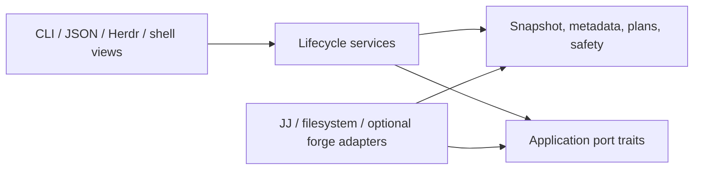

# Architecture

`jj-waltz` keeps command syntax at adapters and puts behavior behind deep module
interfaces. Callers should not reproduce Jujutsu command grammar, lifecycle order,
link validation, or shell switching policy.

This document separates milestone-zero behavior from later publication and forge
work. The current command surface remains authoritative in `jw --help`.

## Product boundary

`jj`, `jw`, and forge clients solve different jobs:

| Owner | Responsibilities |
| --- | --- |
| `jj` | Revision creation and rewriting, conflicts, bookmarks, fetch/push, and operation-log recovery |
| `jw` | Workspace lifecycle, links, repository snapshots, managed intent, and cross-workspace safety |
| `gh` / `glab` | Pull or merge requests, forge checks, and CI state |

`jw` may coordinate a graph or publication step through `jj`, but it does not add
general wrappers for ordinary JJ verbs. Forge and network adapters are optional;
core creation, switching, inventory, local status, links, and removal stay
offline.

## Module map

- `cli` is the terminal adapter. It parses flags, asks questions, and renders
  outcomes.
- `lifecycle` owns creation policy, ordered add/switch workflows, adoption, and
  explicit metadata repair. It loads user config once, applies links, records
  successful switches, and rolls back failed creations.
- `jj` is the only production adapter that starts JJ. It owns frozen operation
  queries, version compatibility, process policy, and typed command errors.
- `observe` refreshes selected working copies, captures one final operation, and
  derives `list`/`status` snapshots without renderer subprocesses.
- `snapshot` defines schema-versioned JSON values and semantic status types.
- `metadata` persists repository-scoped managed-workspace intent.
- `doctor` runs independent read-only checks and always produces a complete report,
  including configured-link health for every managed workspace.
- `workspace` owns Jujutsu workspace discovery and mutation. Its inventory gives
  commands one consistent view; removal is planned before execution.
- `cow` owns copy-on-write file cloning and filesystem capability probing. The
  `workspace` module orchestrates JJ adoption of the clone. The `jj` adapter owns
  listing tracked files and reading and writing JJ's local working-copy state,
  which is not a public interface: every copied state is validated by JJ and
  replaced on rejection.
- `reseed` owns existing-workspace batch reseeding: explicit selection and local
  configuration, frozen planning, sparse-prefill execution, ignored replacement,
  verification, and repository-scoped pending records and receipts. It uses
  public commands through `JjClient`, not creation's private `tree_state` copying.
  Filesystem cloning and validation remain in `cow`; configured links remain in
  `links`. Historical lifecycle metadata is not rewritten by reseeding.
- `freshen::source` owns operation-bound upstream selection and post-fetch graph
  proofs. This foundation does not fetch, advance, or refill workspaces itself;
  preparation/reseed coordination owns those mutations and their journals.
- `links` owns config merging, path confinement, link classification, preflight,
  and filesystem changes.
- `shell` owns shared shell behavior. Each shell adapter varies syntax, not policy.
- `manager` owns the interactive terminal adapter. `manager::ui` owns the Ratatui
  0.30.2 event loop, rendering, keyboard/mouse input, search, and multi-selection;
  it uses Ratatui's crossterm re-export and remains compatible with Rust 1.88.
  `manager::status` derives display state from completed snapshots, while
  `manager::removal` plans and executes eligible removals and
  `manager::preferences` persists the user-local bookmark policy.
- `plugins/herdr` is a separate Cargo workspace and a UI adapter over `jw`. Its
  removal workflow closes Herdr before deleting provenance.



Arrows show allowed source dependencies. Domain values and policies have no
dependency on Clap, terminal formatting, shell syntax, `gh`, or process
execution. Lifecycle services own the port contracts; concrete adapters implement
them and translate external results back into domain values. A separate-process
view such as Herdr crosses through the CLI/JSON boundary. Renderers consume
completed snapshots or plans and never run their own JJ queries.

The interactive manager is another renderer and action adapter at this boundary.
It does not introduce a second repository model or a second JSON contract. Search
and selection stay in manager state; repository services receive named targets and
return completed per-target outcomes.

Do not create one source directory per conceptual noun. Existing deep modules can
own these responsibilities until a split reduces coupling.

## Snapshot boundary

Any status or plan that compares workspaces uses this sequence:

```text
discover repository and selected workspaces
refresh selected working copies
capture final JJ operation ID
query repository and graph facts at that operation
derive statuses in memory
render once
```

Refresh may be current, selected/all, or none. Skipping it trades freshness for
speed and must be represented in output. No status derivation may trigger another
implicit JJ operation after capture.

All JJ process execution belongs behind the central `jj::JjClient` adapter. It
owns safe argument passing, color/pager policy, parsed version and capability
checks, operation-ID capture, template parsing, errors, diagnostics, and test
fakes.

### Creation-base contract

Creation resolves one exact base commit before creating destination workspaces.
With no `--at`, `resolve_creation_base` first runs source `jj status`, then captures
the operation and resolves `@` at that operation. This refresh is necessary because
`operation_id()` and frozen revision queries deliberately do not snapshot. Dirty
tracked changes and normal JJ auto-tracking therefore enter the implicit base.
An empty merge working copy is itself one valid commit, not an ambiguous parent set.

Explicit `--at REVSET` retains the existing frozen-operation resolution branch,
without the new implicit refresh. It must resolve to exactly one commit; no policy
substitutes source `@` for that selection. JJ creates an empty child of the exact
base, which is also recorded in lifecycle metadata. Creation, switching, provenance,
and rollback share this contract; reseed's separate keep/reset semantics are unchanged.

### Source, destination, and creation mode

The CLI resolves an explicit destination against the caller's directory before
entering optional `--from SOURCE`. Existing lifecycle/JJ helpers then share that
source command context. Without `--from`, the current checkout is the source.

`WorkspaceInventory` validates the source's JJ repository pointer and identifies
the owning `.jj/repo` directory for placement. This ownership is distinct from Git
colocation eligibility or a registration named `default`; it remains useful when
the primary registration has been forgotten. Native workspace registrations remain
authoritative for existing names and paths.

For one `--path`, shared resolution uses a matching registration first. Otherwise
it strips a clear primary-basename-plus-`-` prefix (`opencode-fix` becomes `fix`),
or keeps the destination basename (`myfix` stays `myfix`). An explicit `NAME` can
override inference for a new path, but cannot contradict an existing registration.
Destination paths flow through creation preflight, CoW probing, and `AddOptions`,
including ordinary-checkout fallback. Name-only placement remains `repo.NAME`
beside the owning checkout, not an automatic `~/src` or hyphen-based destination.

`CreationMode::resolve` is the single mode policy: CoW/JJ-only by default; positive
CLI choices override config; otherwise CLI opt-outs overlay their matching config
fields. Config preserves unset/true/false intent, allowing `colocate=true` alone
while rejecting explicitly configured CoW plus colocation. Explicit CLI `--cow`
plus `--colocate` also conflicts. No primary-topology or JJ-setting inheritance
selects colocation. See the [operator precedence table](../README.md#creation-mode-precedence).

## Repository-scoped metadata

Dynamic workspace metadata is separate from static user configuration. Resolve
the store from public JJ configuration plumbing:

```text
repo_config = jj config path --repo
store       = parent(repo_config)/jj-waltz/

jj-waltz/
  manifest.json
  workspaces/
    workspace-<stable 128-bit id>.json
```

`manifest.json` records schema version 2 (version 1 remains readable) and a deterministic `repo-<id>` initially
derived from the normalized canonical repository-config path. Once created, the
manifest is authoritative. JJ's secure per-repository config path is stable when
the repository moves, and a moved config directory plus its adjacent `jj-waltz`
store also keeps the persisted identity.
Each schema-versioned workspace record can be written, repaired, or removed
independently and contains only `jw` lifecycle intent such as creation time,
creation operation ID, recorded creation base, associated bookmark, and intended
remote. Writes use a unique same-directory temporary file followed by atomic
replacement. Parse or identity errors are diagnostics, never permission to
silently reset the store. No secrets or forge tokens belong here.

This location is repository-scoped, shared by sibling workspaces, uncommitted,
and avoids undocumented `.jj` layouts. Moving only a checkout while leaving its
repository config or copying a detached metadata store is not automatic
migration; `jw` never searches arbitrary paths or silently adopts an old store.
On an older repository that has never used per-repository configuration, JJ's
documented `config path --repo` query may initialize an empty secure-config
directory. Snapshot and doctor commands still leave the JJ operation and working
copy unchanged.

### In-place reseeding

`reseed::selection` resolves legacy literal groups and table groups with explicit
name/path patterns against a frozen, snapshot-disabled registration inventory.
It retains missing-root registrations rather than classifying broken targets as
unrelated checkouts. Selection never initializes or adopts matched directories.
The optional unmatched policy affects group misses only, not positional names or
target safety. Its aggregate warning is emitted through `run_with_diagnostics`
before planning (and survives later errors); successful reports retain structured
skips and selected roots/origins. Empty remaining selections fail. Resume never
re-expands groups. See [operator syntax](reseed.md#wildcard-groups).

Reseeding records pending intent and successful receipts separately from creation
metadata, beside the repository-scoped store. A reseed advisory lock serializes
reseed callers, not editors, independent JJ commands, or build processes. These
writers must be paused by the operator.

The authoritative repository manifest is initialized before nested reseed storage
is created. This also works for unmanaged native JJ workspaces: initializing the
repository identity does not adopt a workspace or create lifecycle records.
Existing corrupt or nonempty manifest-less stores are rejected rather than reset.

Plans snapshot the prepared source and named targets before capturing exact
revisions. A full, conflict-free prepared source must match the selected source
tree. Full JJ-only targets retain root and `.jj` identity and registration. The
primary checkout and source are never eligible targets. CoW probing, ignored-root
validation, and filesystem/ownership checks precede destructive work.

The donor path uses explicit `--from`, then configured `source`, then a verified
primary checkout of the current repository. Discovery follows JJ identity rather
than searching archive directories or substituting the current feature checkout.
The donor baseline remains explicit/configured. A donor/target tree difference
is handled per path; an explicit donor-baseline mismatch remains an error.

With explicit `--freshen`, `reseed::prepare` first snapshots real source/target
work, fetches the declared remote through `JjClient`, pins the source goal, selects
its empty child, and runs trusted configured argv in the donor. Preparation settings
alone never activate it. The source-keyed journal stays active through target
handoff and blocks new borrowing or freshening that would invalidate unfinished
work, including older unselected target records depending on the donor.

Verified preparation binds the source change/goal, root identities, selected
ignored roots, and logical payload digest. Normal JJ restoration may change a
commit ID; same-change/exact-parent/tree/payload proofs permit recovery without
accepting unrelated tree-equivalent changes. Source ownership and trusted policy
are rechecked before resumed mutation or installer execution. Shared baseline-owned
link configuration is captured after preparation, not mistaken for policy tampering.

All target plans are atomically stored in the preparation batch before individual
pending records are installed. Preparation IDs and immutable plan comparisons
associate pending records/receipts, while mutable runtime link diagnostics are
separate from planned warnings. Lost handoff recreates only missing recorded
intent; completed receipts prevent rerunning finished targets or preparation.
Target checks refuse changed/stale work rather than snapshotting installer changes
into it. The commissioned replacement is explicit `up`, not default-on reseed
freshening; orchestration has not yet been connected to the new source foundation.

Execution clears sparsity, optionally creates a fresh child at a frozen base,
prefills tree-identical paths, expands sparsity, and verifies the exact target
revision. Configured ignored roots are copied only after tracked verification.
An interrupted target is resumed from its pending record before ordinary
snapshotting; partial prefill must never become intended user history. Batch
recovery does not use repository-wide undo.

Stock JJ rejects sparse mutation with `--ignore-working-copy`. Recovery therefore
reconstructs and verifies the entire recorded desired tracked tree before a normal
sparse-clear command can snapshot it. Identical files come from the frozen source;
other recovery bytes come from frozen public JJ file queries. Sparse expansion
runs normally while sparse-empty, where staged prefills are outside the snapshot
selection. Scoped `snapshot.auto-track=none()` prevents unrelated retained files
from entering the desired change. This is a public-CLI recovery protocol, not an
import of JJ's private working-copy state.

See the [operator guide](reseed.md) and
[design](../design/workspace-reseed/reseed0.gpt6a.md) for policy and limitations.

### Local freshening commands and recovery

The existing [`reseed::prepare`](../src/reseed/prepare.rs) engine now accepts local
`[freshen]` policy with either one `command` argv or ordered `commands` argv arrays.
Presence of both is invalid even when empty; no global command policy exists.
The local loader retains `[prepare]` as a deprecated, warned alias and rejects
both table names together. This preserves frozen legacy policy bytes during
recovery instead of silently ignoring old settings or forcing a mid-flight edit.

Preparation journal v2 freezes a `command_sequence` containing `argv`, `completed`,
and `in_flight`. Before spawning a command, the engine durably marks it in flight.
After successful exit, it checks source ownership/policy, the same selected source
change and exact goal parent, the unchanged tracked tree (including new tracked
paths), disk materialization, and frozen targets before acknowledging completion.
Commands execute sequentially in donor cwd without an implicit shell. Any failed
command/proof stops before later commands or target refill. Final source/payload
proof capture remains the prerequisite for target planning and handoff.

Resume skips durable completed steps; an in-flight step may retry after failure
or interruption, including a lost acknowledgement after successful side effects.
There is no exactly-once claim. During preparation, ignored outputs can be partial
and later steps may alter earlier outputs; the current step must tolerate that
state or the operator must repair it. Borrowing stays blocked until final proof
capture. Once verified, the existing frozen payload digest/restoration contract
continues to apply, without rerunning commands to adopt changed data.

V1 preparation records load compatibly into one-step sequences. Only `Verified`
proves legacy completion; other legacy progress is unknown and may retry. Migration
preserves frozen identities, policy bytes, source proof, and target plans. Lookup
and preview only migrate in memory; real progress writes v2. Unsupported versions,
malformed completion positions, or conflicting legacy/v2 command fields fail
closed. Target pending/receipt schemas are unchanged.

No commands means fetch/advance only, not a guessed build. Existing selected
ignored payload may still be copied, explicitly reported as existing rather than
freshly built. There is no automatic payload pruning. The command engine remains
reachable through legacy `reseed --freshen` until the commissioned up integration;
this stage introduces no partial public up command. See
[operator configuration and retry guidance](reseed.md#freshen-the-source).

### Native freshening source foundation

[`SourceSelection`](../src/freshen/source.rs) implements the first foundation of
the [commissioned up workflow](../design/workspace-reseed/up0.gpt6a.md), not a new
CLI command yet. Existing `reseed --freshen` still uses its earlier preparation
path until that integration lands.

The caller snapshots real source work, verifies filesystem bytes, and supplies one
captured operation. Selection and validation use only frozen read-only JJ queries:

1. Derive source base `B` from the sole parent of ordinary undescribed empty `@`;
   otherwise use `@` itself. Described empty changes and merges are not disposable
   scratch. A directly published nonempty source is valid; an unpublished source
   or empty child above unpublished history is not.
2. An explicit source revset wins. Named remote symbols retain their identity even
   when other refs share the same tip. A tracked local symbol can identify its
   remote; other expressions must resolve to a unique recorded remote tip.
   An explicit not-yet-imported branch uses the narrower form described below.
   A configured remote constrains selection; it never silently redirects an
   explicitly named remote.
3. Otherwise collect all applicable tracked pairs. Both the remote and some local
   target alternative must contain `B`. A deleted local relationship or relevant
   remote conflict is retained as a blocker, not silently discarded. Exact and
   descendant local targets compete in the same tier; any ambiguity stops.
   Only when this tier is empty may a unique exact remote target at `B` win,
   including **untracked** refs. Synthetic `@git` refs never identify an upstream.
4. For a recorded remote, require the base, explicit goal, and selected tracked
   local target to be published there before fetch. An unrelated tracked branch
   whose local target descends from `B`, but whose remote does not contain `B`,
   is inapplicable.
   An applicable tracked pair with unpublished local work blocks rather than
   falling through. An untracked remote does not give its unrelated same-named
   local bookmark any authority, and that local bookmark remains untouched.

The serializable selection freezes names, tracking state, old target IDs, source
facts, and operation for the eventual preparation journal. After the coordinator
fetches, validation rereads **the same ref**, requires old remote ancestry in the
fetched remote (not merely source-base ancestry), and rejects deletion, conflicts,
tracking changes, local unpublished work, or sideways/rewound goals. A tracked
local may lag the remote if it remains published; no repair is performed.
Explicit revsets are reevaluated as goals on that pinned line; a fixed ID can
deliberately stay fixed rather than implicitly becoming a bookmark-following rule.

For an **explicit not-yet-imported branch**, the supported form is unquoted
`branch@remote`, for example `introduced-later@origin` or
`feature/new-line@origin`. Branch components contain ASCII letters, digits, `_`,
internal `-` and `.`, separated by `/`; a component cannot begin/end with `.` or
`-`, contain `..`, or end in `.lock`. The remote uses one such component and must
already be configured in native JJ Git configuration. Synthetic `git` is excluded.
This deliberately narrow interface does not reinterpret quoted names, patterns,
operators, arbitrary revsets, or nonexistent local bookmark names as new branches.
Use explicit `branch@remote` rather than asking a missing local name to imply a
remote; pre-import unusually named branches with native JJ before selecting them.

Selection first asks native JJ whether the expression resolves. Syntax/query
errors and multiple results are not treated as absence. Existing unresolved or
deleted remote records remain blockers, including native tracked placeholders;
they are not reclassified as new branches. Existing known-ref conflict and
fast-forward checks remain unchanged.

Missing-ref intent serializes old remote ID, old goal ID, and tracking state as
**unknown (`null`)**, alongside the exact requested name/remote and full source
snapshot. Preview does not fetch or claim the goal is prepared. The adapter's
`fetch_bookmark` fetches that one exact branch from that one remote, not all
remotes or guessed/default branches. Native Git remote configuration is live,
not part of the frozen JJ operation; the coordinator must retain its existing
policy/identity revalidation boundary before mutation.

Publication may only become knowable after this fetch. Until then, potentially
local source history is preserved, not discarded as scratch. Afterward the same
source/base and fetched-goal publication checks must pass before any source
advancement or configured command. Still-absent refs, divergent source history,
and unpublished source work stop there. Native auto-tracking may import the new
line; any resulting tracked local conflict/unpublished work also blocks. With no
old remote ID there is **no prior fast-forward proof**; validation establishes
publication on the newly imported goal without inventing an old remote baseline.

The source must remain the same revision. One safe normalization is allowed:
native JJ can create an ordinary empty child above a directly published source
when that checkout becomes immutable during fetch. The original tree and history
are unchanged. Filesystem proof, ownership checks, and the exact accepted source
revision still belong to the coordinator; graph queries do not prove disk bytes.
Once the fetched goal is frozen, recovery must use it rather than selecting or
fetching again. There is no permanent following state, operation-log inference,
default-branch heuristic, or automatic bookmark movement.

[`tests/freshen_source.rs`](../tests/freshen_source.rs) exercises these boundaries
using disposable local Git remotes, including the exact-main/advanced-dev
ambiguity, untracked remote with unrelated local dev, unpublished empty-parent
history, conflicts, old-remote rewind, and native immutable-checkout normalization.
The original 14 cases passed on pinned JJ 0.39.0, 0.44.0, 0.45.1, and 0.46.0.
The missing-ref extension adds six focused cases: all 20 source cases pass on the
installed JJ 0.45.1 development build, with the six missing-ref cases separately
verified on official JJ 0.46.0. This extension did not rerun the full release
matrix or unrelated suites. No live source was mutated.
These are graph/reference checks; this foundation changes no CoW copying path and
does not claim a new end-to-end up or reflink verification.

### Metadata repair

`jw repair NAME --base REVSET (--bookmark BOOKMARK | --no-bookmark)` is the explicit
correction path for an existing readable managed record. `NAME` is literal and must
identify a workspace registered with JJ at one captured validation operation. The
replacement base resolves to exactly one revision at that operation; a requested
bookmark must already exist locally. The checkout path need not be readable or
present.

Repair replaces only `creation_base_commit_id` and `associated_bookmark`. It preserves
creation time, creation operation ID, and intended remote. The record is replaced
atomically only if it still matches the validated old record; validation failure,
write failure, or concurrent change leaves the old record intact. Repair does not
create a JJ operation, change commits or bookmarks, refresh a working copy, or
create a usable checkout. Missing records remain an adoption case, and corrupt
records remain a restore/manual-repair case.

## Workspace-link health

The default workspace owns `.jwlinks.toml` and `.jwlinks.local.toml`. The local file
overrides a shared entry with the same `source`. Each configured entry is evaluated
once per managed workspace. Its `source` is relative to, and confined within, that
receiving workspace; a relative `target` is resolved from the same receiver. Doctor
does not inspect unmanaged workspaces because they have no `jw` link intent.

The link classifier is shared with link application and recognizes four outcomes:

| Outcome | Meaning | Doctor result |
| --- | --- | --- |
| Satisfied | Source resolves canonically to target, including an ordinary path | `PASS` |
| Missing | Source is absent while its target exists, or a required target is absent | `FAIL` |
| Skipped | Optional target is absent and source is absent or the correct dangling link | `WARN`/`SKIP` |
| Conflicting | Source is occupied by an ordinary private path or a link to another target | `FAIL` |

An existing managed record whose workspace path is stale or missing still appears in
doctor's workspace checks; link inspection for that record is `SKIP` because the
receiving root cannot be read. This keeps the workspace failure visible without
guessing at paths.

## Interactive manager boundaries

The manager compares recorded bookmark targets and workspace publish tips with
resolved trunk independently. Only local ancestry establishes “in trunk”; a squash
merge is not inferred. Unmanaged workspaces have no authoritative association.
The existing JSON schema and CLI status contracts remain unchanged.

The UI renders immediately, then receives completed snapshots from one background
worker. Search, selection, and rendering do not start JJ processes. Explicit
inspection and removal preparation refresh named working copies; browsing does
not. Rendering is event-driven so idle frames do not disturb native terminal text
selection. The mouse-mode toggle releases terminal mouse capture without changing
keyboard controls. Generation IDs reject obsolete results. Repository-changing work is serialized
and must finish before switching or exiting; terminal state is restored on failure.

Removal previews list every target and its directory, associated local bookmark,
risks, and ignored content. Default/current workspaces and unsafe or unreadable
identities are blocked. Risky rows require explicit inclusion. For eligible rows
with unrecorded content, the preview requires a batch choice to delete that content
or skip those workspaces before execution. The final check compares filesystem identity,
workspace revision, metadata, bookmark targets, and ignored-file inventory with
the reviewed plan. Changed targets require another review. Independent targets
continue after failure, and outcomes describe any partial progress. A directory
removal is permanent; JJ history cannot restore unrecorded files.

Bookmarks associated with surviving managed workspaces are retained. The last
confirmed keep/delete choice is user-global state in
`$XDG_STATE_HOME/jj-waltz/ui.json`, falling back to
`~/.local/state/jj-waltz/ui.json`. It is separate from static configuration and uses
the existing atomic file writer. A preference-write failure is reported separately
and does not block a confirmed removal. Network and remote bookmark operations are absent.

Shell adapters reserve stdout for a selected destination through `--ui-path`;
the interface and diagnostics use stderr. Cancellation emits no destination.
The initial screen clear also uses stderr: Ratatui's cursor-preserving clear
queries the cursor through stdout and cannot be used on the captured path channel.

Keep Ratatui and its crossterm re-export inside the terminal adapter. Lifecycle
services own creation and switching; doctor supplies read-only health results.

## JSON schema version 1

Any command that offers JSON uses one versioned envelope and writes only JSON to
stdout. Diagnostics and warnings that are not envelope data go to stderr.

```json
{
  "schema_version": 1,
  "command": "<command>",
  "repository": {
    "operation_id": "<operation id>"
  },
  "workspaces": [],
  "warnings": []
}
```

Within schema version 1, producers may add optional fields. Known optional values,
including a missing bookmark or creation base, remain explicit `null` fields.
Consumers must ignore unknown optional fields and treat unknown enum values as
unsupported data rather than guessing. Removing or renaming a field, making an
optional field required, or changing an existing enum value's meaning requires a
new schema version. Human output is not governed by this machine contract.

Mutation plans use the same versioned-envelope rule. ANSI escapes never appear
in JSON.

`doctor` deliberately uses a separate schema-versioned envelope. A repository
snapshot requires one resolved trunk, while doctor must serialize useful checks
when trunk resolves to zero or multiple revisions, metadata is corrupt, or a
workspace path is missing. CLI rendering completes before an unhealthy doctor
returns a failing exit status.

Doctor's `workspace-link` diagnostic code is additive within schema version 1. The
human renderer uses `PASS`, `WARN`, `FAIL`, and `SKIP`; machine output retains the
existing `passed`, `failed`, and `skipped` states and uses severity to distinguish
optional warnings from informational skips and errors. Consumers must ignore
unknown additive diagnostic codes and fields. `jw status` remains a single-workspace
snapshot and does not inspect link health.

Metadata repair is a human lifecycle command. It does not add a JSON schema or link
health field to `jw status`.

## Copy-on-write creation

Copy-on-write is the default creation mode. Creation probes the destination
filesystem before destination mutation and falls back to ordinary JJ workspace
creation with a warning if it cannot clone.
Otherwise it adds the workspace with empty sparse patterns, clones the files JJ
tracks in the source workspace's working-copy commit, and copies that source's
working-copy state. Ignored and untracked files are never cloned; the implicit
base refresh may first auto-track files according to ordinary JJ rules.
A JJ snapshot validates the copied state; if JJ rejects it, the previous state is
restored, the attempted clone workspace is rolled back, and JJ recreates it
through its ordinary workspace-add path, preserving the source sparse patterns.
On successful state adoption, `jj restore` then makes `@` match the creation base exactly before provenance is
captured, so the recorded creation operation describes a complete checkout.

Watchman or rejected copied state also trigger the existing ordinary-checkout
fallback. Each materialization fallback carries a reason in `AddResult`; lifecycle
outcomes collect it alongside filesystem-preflight warnings. The CLI renders these
on stderr, preserving shell path stdout, and the manager displays a warning report.
Ordinary-checkout fallback is not reported as CoW success. No strict-mode flag or
fallback-policy change is introduced here.

## Failure order

Creation preflights what it can, creates the workspace, applies required setup,
then records switching state. Failure removes any workspace, bookmark, links, and
directories created by that operation; cleanup failures are attached to the
original error.

Removal builds a plan before mutation. CLI callers choose whether associated
bookmarks should be deleted. Herdr removal keeps its provenance marker until the
container close reports success; a stale marker is safer than lost recovery data.

## Test surfaces

```bash
cargo fmt --all --check
cargo clippy --all-targets --all-features -- -D warnings
cargo test --locked

cd plugins/herdr
cargo fmt --all --check
cargo clippy --all-targets --all-features -- -D warnings
cargo test --locked
```

JJ 0.39.0 is the oldest supported release. CI runs root integration tests against
0.39.0 and the newer pinned compatibility targets, 0.44.0, 0.45.1, and 0.46.0,
on Linux, macOS, and Windows. macOS tests require real copy-on-write success. The adapter
keeps version-specific behavior at the boundary: `jw doctor` recommends
`jj converge --no-interactive` for divergence on JJ 0.45 and newer, while older
supported versions receive manual recovery guidance. A minimum-version bump
requires a documented public JJ capability that cannot reasonably be adapted.
Newer JJ versions may work, but are not part of the declared window until the pin
is advanced. Herdr is checked separately because it is a separate Cargo
workspace.


### External checkout lifecycle

Workspace metadata schema 2 adds an optional `external_owner` with the actual linked
Git checkout root, Git admin directory, and common directory. Schema 1 manifests and
records remain readable. Adoption and registration inspect actual topology; repair
preserves ownership. Older or absent records still receive live topology checks.

CLI removal, manager preview and execution, pruning, and rollback revalidate ownership
before native `workspace remove` or `workspace forget`. An externally owned linked
Git checkout or remaining external Git registration is
ineligible for destructive cleanup; uncertainty fails closed. A native app owns its
checkout even after JJ adoption. Creation uses the shared
[mode resolver](#source-destination-and-creation-mode), defaulting to CoW/JJ-only.
Explicit `--colocate` or configured colocation requests an ordinary Git worktree
checkout; `--colocate` alone overrides default/configured CoW.
New colocated workspaces have jw ownership recorded through the same explicit
creation path; existing workspaces are never converted by a default change.
This fork's current defaults supersede v0.8.0's automatic colocation inheritance.
Explicit colocation still requires advertised JJ support and a Git backend.

Existing-directory removal probes `workspace remove --help` and uses native
snapshotting/removal when advertised (JJ 0.46+); minimum support remains JJ 0.39.
Keep-directory, missing-directory, rollback, and older-JJ cleanup retain guarded
forgetting. Both commands share the owned Git-link detachment and exact-registration
cleanup boundary, preventing JJ 0.46's global prune from touching unrelated missing
registrations. Workspace absence is verified even after command failure; native
removal never retries through custom deletion. A remaining directory is reported as
partial progress after bookmark/metadata cleanup, including JJ's warning-only failures.

`reconcile-external` is separate from automatic pruning. It verifies that the recorded
checkout and Git admin directory are absent and the live registration is gone,
rechecks immediately before forgetting any remaining JJ workspace, and removes only
the matching metadata. It neither deletes files or Git registration nor rewrites
commits or removes bookmarks. Doctor reports external ownership and routes cleanup
through the owning app before explicit reconciliation.
